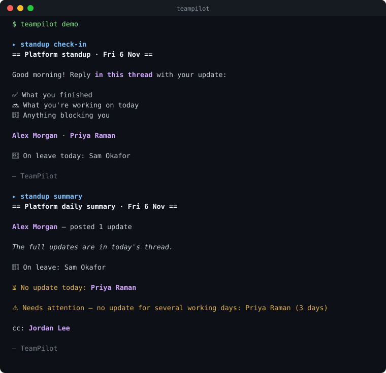
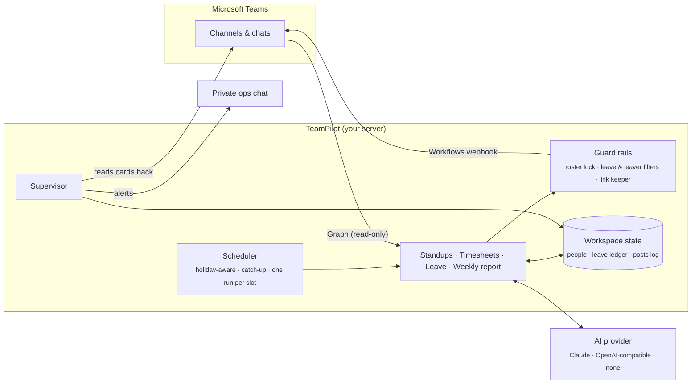

<div align="center">

# 🧭 TeamPilot

**Team operations on autopilot for Microsoft Teams.**

Daily standups · weekly timesheets · leave tracking · leadership reports.<br/>
A built-in supervisor checks every card before your team spots a problem.

[](https://github.com/Kumar-Gourabh/teampilot/actions/workflows/test.yml)




</div>

---

## Why TeamPilot

Someone on every team chases standup updates, reminds people about timesheets, keeps a leave
sheet current and writes the Friday update for leadership. The work is repetitive, easy to get
slightly wrong, and very visible when it is wrong. Common mistakes include pinging someone on
leave, tagging a person who left last month, or a summary that credits work nobody did.

TeamPilot does that work on a schedule. Its guard rails are enforced **in code, not in
prompts**, so it's safe to put in front of a whole team and its leadership.

## Features

| | Module | What it does |
|---|---|---|
| 🗣️ | **Standups** | Posts the morning check-in and reminds **only** the people who haven't replied. The evening summary covers what people actually wrote, plus who is on leave, who is missing, and who has gone quiet for several days. Runs any number of teams, with replies in a thread or a group chat. |
| ⏱️ | **Timesheets** | Posts one weekly reminder (with a holiday line when needed). It counts a "done" reply, a screenshot, a reaction or a coordinator's "done for @name". Nudges go only to people still pending, and the final list goes to coordinators. Fully deterministic, with no AI. |
| 🌴 | **Leave** | Reads leave announcements people already post ("off Friday", "sick today") and records them. When it's unsure, it asks once, and a reply corrects the entry. Every module uses this, so **nobody on leave gets chased**. |
| 📊 | **Weekly report** | A Friday card for leadership: each team's highlights from its real updates, participation, leave, and timesheet status. |
| 🛡️ | **Supervisor** | Watches everything above. It flags failed jobs, posts that never landed, duplicates, summaries naming someone who didn't post, people tagged after they left, expired sign-ins and stalled leave reading. Alerts go to a private chat once each, with an all-clear at the end of the day. |

**Many workspaces, one install.** Each company, client or project gets its own isolated
workspace: people, schedule, channels, secrets and history.

## How it works



- **Reads** go through Microsoft Graph with read-only delegated scopes. **Posts** go through
  Teams Workflows webhooks. TeamPilot can't edit or delete anything in Teams.
- **AI is optional.** Claude is the default; any OpenAI-compatible endpoint works as the main
  provider or a fallback. With no AI, cards fall back to a plain layout.

## Guard rails

| Never… | …because |
|---|---|
| @mentions someone on leave, someone who has left, or anyone marked never-tag | every tag goes through one directory and one leave ledger |
| credits work to someone who didn't post | person-led summary lines are kept only for people with an update |
| invents "wins" on a quiet day | a day with no updates gets a fixed, plain card; the AI isn't asked |
| drops a link someone shared | links missing from the AI output are added back |
| posts the same card twice | each post has a per-day key; restarts and catch-ups are safe |
| assumes a webhook "202" means the card landed | the supervisor reads every venue back |
| lets a cron slot silently never fire | slots outside the host's uptime window are flagged |
| overwrites a human correction | manual leave entries always win over automation |

## Quick start

**1. Node.js 20+** on macOS or Linux (Windows via WSL or Docker):

```bash
brew install node                                          # macOS
curl -fsSL https://deb.nodesource.com/setup_22.x | sudo -E bash - && sudo apt-get install -y nodejs   # Ubuntu / Debian
```

**2. Install TeamPilot.** One command, no GitHub account needed:

```bash
curl -fsSL https://raw.githubusercontent.com/Kumar-Gourabh/teampilot/main/install.sh | TEAMPILOT_TARBALL=https://github.com/Kumar-Gourabh/teampilot/releases/download/v0.1.0/teampilot-0.1.0.tgz bash
```

It installs to **~/.teampilot/app** and adds a **teampilot** command in **~/.local/bin**
(if that folder isn't on your PATH yet, run the line it prints). It doesn't need sudo.
Re-running it upgrades TeamPilot, and your workspaces are never touched.

<details>
<summary>Or install from a clone of the repo</summary>

```bash
git clone https://github.com/Kumar-Gourabh/teampilot.git
cd teampilot && ./install.sh
```

</details>

**3. Try it, then set up a workspace:**

```bash
teampilot demo                     # every card on sample data: no accounts, nothing posted
teampilot init acme                # create a workspace (one per company or project)
teampilot login acme               # one-time Microsoft 365 sign-in (device code)
teampilot discover acme            # find team, channel and chat ids
teampilot doctor acme --online     # check config, secrets, sign-in and channel access
teampilot run acme standup:platform:summary --dry   # preview exactly what would post
teampilot service acme             # print a systemd unit or launchd plist
```

<details>
<summary><b>A taste of the configuration</b></summary>

```yaml
workspace:
  name: Acme Engineering
  timezone: Europe/London

venues:
  standup-channel: { webhook: WEBHOOK_STANDUP, teamId: "…", channelId: "…" }
  ops-alerts:      { webhook: WEBHOOK_ALERTS }

modules:
  standup:
    teams:
      - key: platform
        name: Platform
        venue: standup-channel
        members: [alex, priya, sam]
        cc: [jordan]
        escalate: { to: [jordan], afterDays: 3 }
        schedule:
          checkin: "0 10 * * 1-5"
          nudge:   "0 15 * * 1-5"
          summary: "30 17 * * 1-5"

  supervisor:
    alertVenue: ops-alerts
    owners: [jordan]
    schedule: { passes: ["45 10 * * 1-5", "30 14 * * 1-5"], endOfDay: "30 18 * * 1-5" }
```

People live in one **people.yaml**. When someone leaves, set their last working day; they
drop out of every module the next day and their history is kept.

</details>

## Everyday commands

| Command | |
|---|---|
| `teampilot jobs acme` | what runs today, and when |
| `teampilot leave acme list` | who's off in the next two weeks |
| `teampilot leave acme set priya 2026-11-20 --code AL` | record leave by hand (wins over automation) |
| `teampilot timesheet acme status` | who has confirmed this week |
| `teampilot people acme depart sam 2026-11-30` | offboard someone everywhere at once |
| `teampilot supervisor acme check` | run every check now and print the findings |

## Deploy

- **Linux server:** systemd template unit, one service per workspace (`teampilot@acme`)
- **macOS:** launchd plist
- **Docker:** `deploy/docker/` (Dockerfile + compose, one service per workspace)

Upgrading means re-running `install.sh`. It never touches workspaces.

## Documentation

| | |
|---|---|
| [Microsoft 365 setup](docs/SETUP-MICROSOFT-365.md) | app registration, permissions, webhooks |
| [Configuration](docs/CONFIGURATION.md) | every setting, by module |
| [Operations](docs/OPERATIONS.md) | the daily rhythm, and what to do when something breaks |
| [Developing and releasing](docs/RELEASING.md) | work on the code, publish a version, upgrade an install |
| [Roadmap](docs/ROADMAP.md) | what's next |
| [Security](SECURITY.md) | access, secrets and what reaches the AI |

## Development

```bash
npm install
npm test            # unit + end-to-end tests, no network needed
npm run package     # builds dist/teampilot-<version>.tgz for install.sh
```

The project layout is `src/core/` (people, leave ledger, Graph, posting, AI, scheduler) and
`src/modules/` (one folder per module).

## License

Copyright © 2026 Kumar Gourabh. All rights reserved. See [LICENSE](LICENSE).
For licensing or commercial use, contact **kumargourabh94@gmail.com**.
